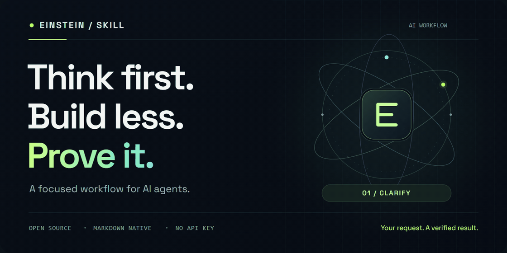

<p align="center">
  <picture>
    <source media="(prefers-reduced-motion: reduce)" srcset="assets/social-preview.png">
    
  </picture>
</p>

<h1 align="center">Einstein-skill</h1>

<p align="center">
  <strong>Make your AI think before it builds.</strong><br>
  Clear assumptions. Focused changes. Evidence you can inspect.
</p>

<p align="center">
  <a href="https://github.com/SaeedAngiz1/Einstein-skill/actions/workflows/validate.yml"></a>
  <a href="https://github.com/SaeedAngiz1/Einstein-skill/releases/latest"></a>
  <a href="LICENSE"></a>
  <a href="https://agentskills.io/specification"></a>
</p>

<p align="center">
  <a href="#start-in-seconds">Get started</a> &nbsp; / &nbsp;
  <a href="#four-corrections-one-focused-workflow">The workflow</a> &nbsp; / &nbsp;
  <a href="skills/einstein-skill/references/examples.md">Examples</a> &nbsp; / &nbsp;
  <a href="docs/evaluation.md">Evaluate it</a> &nbsp; / &nbsp;
  <a href="https://github.com/SaeedAngiz1/Einstein-skill/releases/latest">Download</a>
</p>

---

## Big output. Wrong direction. Sound familiar?

You ask for a small fix. Your agent guesses a requirement, adds an abstraction, changes working code nearby, and says it is done.

**Einstein-skill brings the work back to your actual request.** It teaches an agent to resolve meaningful uncertainty, choose a simple complete solution, protect existing behavior, and show what was verified.

> **Think first. Build less. Prove it.**
>
> Portable Markdown instructions. No API key. No background service. No runtime dependencies for the skill itself.

## Start in seconds

Requires Node.js and an agent supported by the [Skills CLI](https://skills.sh/docs/cli).

```sh
npx skills add SaeedAngiz1/Einstein-skill --skill einstein-skill
```

Choose your agent and scope in the installer, then use the skill:

**Claude Code**

```text
/einstein-skill Fix the duplicate-submit bug. Preserve the current API.
```

**Codex**

```text
Use $einstein-skill to fix the duplicate-submit bug. Preserve the current API.
```

<details>
<summary><strong>More installation options</strong></summary>

Install user-wide in Claude Code and Codex:

```sh
npx skills add SaeedAngiz1/Einstein-skill --skill einstein-skill --agent claude-code codex --global
```

Other agents can read [SKILL.md](skills/einstein-skill/SKILL.md) directly. The [release ZIP](https://github.com/SaeedAngiz1/Einstein-skill/releases/latest) contains the four distributable skill files and includes a published checksum.

The [Agent Skills format](https://agentskills.io/specification) makes the instructions portable; this does not imply every client has been tested. See the [Claude Code skill docs](https://code.claude.com/docs/en/skills) for invocation details.

</details>

## Four corrections. One focused workflow.

| | When the agent… | Einstein-skill teaches it to… |
| :---: | --- | --- |
| **01 · CLARIFY** | Guesses what you meant. | Inspect the context, expose consequential assumptions, and ask when the answer changes the result. |
| **02 · SIMPLIFY** | Turns a small task into a framework. | Build the smallest complete solution. Add complexity for actual requirements. |
| **03 · FOCUS** | Rewrites working code around the fix. | Tie changes to your requested outcome and preserve contracts and other people's work. |
| **04 · VERIFY** | Declares success without checking. | Define observable acceptance. For a reproducible bug, confirm failure before the fix and success after it. |

**Smaller still has to be complete.** Preserve the security, accessibility, error handling, and edge cases the task needs. Fewer lines help when behavior and readability survive.

## A request becomes a clear outcome

**You ask**

> Add a CSV export of the table that's on screen.

**The agent establishes the scope**

> I'll export the currently filtered rows in their displayed order, using the existing columns. I'll check CSV escaping and an empty result.

**Then it delivers** the focused export and its verification evidence. If context doesn't establish whether export means filtered rows or all rows, it asks before choosing.

<sub>Illustrative interaction, not a recorded model benchmark.</sub>

## Judgment without the ceremony

- **Ask when it matters.** Resolve cheap uncertainty from context; keep moving on reversible choices within scope.
- **Protect the surrounding work.** Make necessary integration changes and leave unrelated cleanup for a separate task.
- **Match proof to the task.** Inspect a design, check a document, reproduce a bug, or validate research against sources.
- **Know when to finish.** Deliver once the requested outcome and relevant checks are satisfied.

[Explore examples →](skills/einstein-skill/references/examples.md) &nbsp; Coding · documents · design · research

## Open instructions. Inspectable evidence.

| Explore | What you get |
| --- | --- |
| [The skill](skills/einstein-skill/SKILL.md) | The complete operating instructions your agent reads. |
| [10 behavioral cases](evals/cases.json) | Concrete requests with observable success and failure criteria. |
| [Comparison protocol](docs/evaluation.md) | A way to compare matched tasks with and without the skill. |
| [Validation record](docs/validation.md) | The package and installer checks actually performed. |
| [Launch kit](docs/launch-kit.md) | Ready-to-adapt copy and an honest demo outline. |

Package checks validate structure and links. They do **not** measure model performance. No productivity, token-saving, or correctness percentage is claimed.

<details>
<summary><strong>Contribute a concrete improvement</strong></summary>

Open an issue or PR with a failing request, the relevant artifact, the observed behavior, and the smallest useful correction. Remove private information first.

Validate the package locally:

```sh
python -m pip install -r requirements-dev.txt
python scripts/validate.py
```

The visual assets have an editable [SVG source](assets/hero.svg) and a [render script](scripts/render_readme.py). The bundled [Space Grotesk font license](assets/fonts/OFL.txt) covers the font used in those assets.

</details>

<details>
<summary><strong>Origin and credit</strong></summary>

Created by [SaeedAngiz1](https://github.com/SaeedAngiz1) from a user-supplied short video visibly credited to **@agenticfact**. The clip presents coding lessons associated with Andrej Karpathy. The related [Karpathy-inspired guidelines](https://github.com/multica-ai/andrej-karpathy-skills) cover the same four themes.

Einstein-skill is an independent implementation with adaptive clarification, scope boundaries, evidence limits, and evaluation cases. Its name is project branding; it is not an Albert Einstein quotation or an endorsement by the people named above.

[Timestamped source notes](docs/source-notes.md) explain the adaptations. The source video, audio, and transcript are not distributed here.

</details>

---

<p align="center">
  <strong>One real task is worth more than a hundred promises.</strong><br>
  Try it. Inspect the result. Share the evidence.<br><br>
  <a href="https://github.com/SaeedAngiz1/Einstein-skill/stargazers">Star the project</a> &nbsp; · &nbsp;
  <a href="https://github.com/SaeedAngiz1/Einstein-skill/issues">Share a counterexample</a> &nbsp; · &nbsp;
  <a href="LICENSE">MIT licensed</a>
</p>
