<p align="center">
  
</p>

<p align="center">
  <a href="https://github.com/SaeedAngiz1/Einstein-skill/actions/workflows/validate.yml"></a>
  <a href="LICENSE"></a>
  <a href="https://agentskills.io/specification"></a>
</p>

# Einstein-skill

**Make your AI think before it builds.**

An AI workflow skill for the moments when an agent guesses your goal, overbuilds the solution, rewrites working code, or declares victory without checking the result.

**Think first. Build less. Prove it.**

## Install in one command

Requires Node.js and an agent supported by the [Skills CLI](https://skills.sh/docs/cli):

```sh
npx skills add SaeedAngiz1/Einstein-skill --skill einstein-skill
```

Choose your agent and installation scope in the installer. For a user-wide install in Claude Code and Codex:

```sh
npx skills add SaeedAngiz1/Einstein-skill --skill einstein-skill --agent claude-code codex --global
```

The skill itself is Markdown. It runs no background service and requires no API key or runtime dependencies. Contributor validation uses Python and PyYAML.

## Use it

In Claude Code:

```text
/einstein-skill Fix the duplicate-submit bug. Preserve the current API.
```

In Codex:

```text
Use $einstein-skill to fix the duplicate-submit bug. Preserve the current API.
```

Other agents can read [SKILL.md](skills/einstein-skill/SKILL.md) directly. These are portable instructions, not a claim that every client has been tested. See the [Agent Skills format](https://agentskills.io/specification) and [Claude Code skill docs](https://code.claude.com/docs/en/skills).

## Four corrections that change the work

| Failure | Einstein-skill response |
| --- | --- |
| The agent silently guesses what you mean. | Check the available context; expose assumptions that change the result. Ask when the missing answer matters. |
| A small request turns into a framework. | Choose the smallest complete solution. Add complexity only for a real requirement. |
| A fix changes unrelated working code. | Trace edits to the requested outcome. Preserve behavior, conventions, and other people's work. |
| The agent says it works without proving it. | Define an observable check. For a reproducible bug, show the same check failing before and passing after. |

**Smallest complete** matters. Security, accessibility, error handling, and edge cases required by the task still belong in the solution. Fewer lines are useful only when behavior and readability survive.

## What a good run looks like

Illustrative interaction, not a recorded benchmark:

**You:** "Add a CSV export of the table that's on screen."

**Agent:** "I'll export the currently filtered rows in their displayed order, using the existing columns. I'll verify CSV escaping and an empty result."

Then it implements that export, checks the result, and reports the evidence. No export framework, background queue, analytics, or settings page unless the task actually needs them.

If repository behavior doesn't establish whether "export" means all rows or filtered rows, it asks that specific question before choosing.

## Built for judgment, not ceremony

- **Consequential questions.** Resolve cheap uncertainty from context. Ask about decisions that change correctness, scope, cost, or authorization.
- **Focused edits.** A required dependency or integration change is allowed; unrelated cleanup is a separate task.
- **Evidence with limits.** Passing tests supports tested behavior. A design needs inspection; a business hypothesis needs real observations.
- **A stopping point.** Once the requested outcome and relevant checks are satisfied, deliver it. Don't invent more work.

The core skill is deliberately short. [Examples](skills/einstein-skill/references/examples.md) cover coding, document edits, design, and research.

## Evaluate it yourself

The repo includes [behavioral cases](evals/cases.json) and a [comparison protocol](docs/evaluation.md). Run the same task with and without the skill and inspect the artifacts, changes, questions, and checks.

Package validation checks structure and internal links. It does **not** measure model performance. No productivity, token-saving, or correctness percentage is claimed for this release.

See the [validation record](docs/validation.md) for the checks actually performed.

To validate a contribution:

```sh
python -m pip install -r requirements-dev.txt
python scripts/validate.py
```

To contribute, open an issue or PR with a concrete failing request, the relevant artifact, the observed behavior, and the smallest proposed correction. Remove private information first.

## Origin and credit

Created by [SaeedAngiz1](https://github.com/SaeedAngiz1) from a user-supplied short video visibly credited to **@agenticfact**. The clip presents coding lessons associated with Andrej Karpathy. The related [Karpathy-inspired guidelines](https://github.com/multica-ai/andrej-karpathy-skills) cover the same four themes.

Einstein-skill is an independent implementation with adaptive clarification, explicit scope boundaries, evidence limits, and evaluation cases. Its name is project branding; it is not an Albert Einstein quotation or an endorsement by the people named above.

[Timestamped source notes](docs/source-notes.md) explain the adaptations. The source video, audio, and transcript are not distributed here. [Launch copy and demo outline](docs/launch-kit.md) are ready to adapt.

**Try one real task. If it helps, share the actual diff and evidence.**
